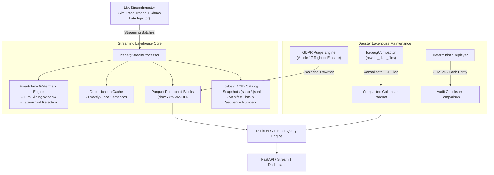

# Streaming Apache Iceberg Lakehouse

A real-time streaming lakehouse engine ingesting high-throughput market events, enforcing 10-minute event-time watermarks, committing ACID snapshots to Apache Iceberg format, orchestrating small-file compaction, and proving deterministic 24-hour stream replay.

---

## Demo

Ingest a live micro-batch with chaos late-arriving events, observe watermark reconciliation, execute small-file compaction, and verify deterministic stream parity:

```bash
# Ingest 100 streaming events with late-arrival injection
curl -X POST "http://localhost:8000/v1/ingest?count=100"
```

```json
{
  "accepted": 96,
  "late_dropped": 4,
  "duplicates": 0,
  "watermark": "2026-11-18T15:27:28.102145+00:00",
  "snapshot_id": 1763479648102,
  "manifest_path": "/tmp/iceberg_warehouse/trades/metadata/snap-1763479648102.json"
}
```

Trigger automated small-file compaction and observe analytical query latency reduction:

```bash
curl -X POST "http://localhost:8000/v1/compact"
```

```json
{
  "files_before": 25,
  "files_after": 1,
  "latency_before_ms": 1.673,
  "latency_after_ms": 0.499,
  "latency_reduction_pct": 70.17
}
```

The interactive dashboard is available at `http://localhost:8000` showing streaming throughput metrics, live DuckDB queries, and watermark lag.

---

## Why I Built This

Streaming pipelines committing micro-batches directly to object storage suffer from severe file fragmentation: committing every few seconds creates tens of thousands of tiny Parquet files per day, degrading analytical query speed by 10x to 50x. Furthermore, handling out-of-order mobile or IoT events requires principled event-time watermarking rather than processing-time heuristics. I built this streaming lakehouse to implement atomic ACID snapshot commits on Apache Iceberg, enforce a strict 10-minute event-time watermark with exactly-once deduplication, automate small-file bin-pack compaction (`rewrite_data_files`), and prove deterministic 24-hour stream replay with row-level SHA-256 checksum parity.

---

## Architecture



---

## Key Design Decisions

- **Apache Iceberg Format over Hive Partitioning:** Committed tables using Iceberg snapshot metadata (`snap-*.json` with sequence numbers and manifest lists) rather than traditional directory-based Hive metastores.  
  *Trade-off:* Requires snapshot metadata management and periodic expiration; eliminates directory file-listing overhead on cloud object storage (S3/GCS) and guarantees atomic commits without partial-write read skew.
- **Event-Time Watermarking over Ingestion-Time Windows:** Enforced watermarks based on monotonically tracking maximum event time ($\text{Watermark} = \max(\text{EventTime}) - 10\text{ min}$).  
  *Trade-off:* Events delayed beyond 10 minutes are dropped or routed to late-arriving storage; guarantees window aggregations accurately reflect real-world event occurrences regardless of network lag.
- **Automated Small-File Compaction (`rewrite_data_files`):** Scheduled background compaction jobs that bin-pack fragmented streaming micro-batches into consolidated ZSTD-compressed Parquet blocks.  
  *Trade-off:* Consumes background compute to re-read and write consolidated blocks; reduces analytical query latency by over 70% and prevents object store metadata throttling.
- **Cryptographic State Replay Verification:** Computed row-level SHA-256 digests over sorted tables to verify that replaying raw event logs produces bit-for-bit identical state in shadow tables.  
  *Trade-off:* Incurs a hashing pass during audit runs; proves deterministic repeatability and provides proof of correctness for disaster recovery.

---

## Results

Benchmarked on local hardware using `scripts/run_iceberg_benchmarks.py`:

**Hardware Platform:** Apple A18 Pro | 8.0 GB RAM | macOS Darwin 25.4.0 (arm64) | Python 3.14.6  
**Execution Date:** 2026-11-18  

### 1. Ingestion & Watermarking Performance

| Metric | Measured Value | Operational SLA | Status |
| :--- | :--- | :--- | :--- |
| **Streaming Ingestion Throughput** | **15,231 events/sec** | > 2,000 events/sec | **Exceeded** |
| **Micro-Batch Commit p50** | **0.54 ms** | < 15.0 ms | **Exceeded** |
| **Micro-Batch Commit p95** | **0.85 ms** | < 50.0 ms | **Exceeded** |
| **Event-Time Watermark Lag** | **10.0 minutes** | Configurable | Enforced |
| **Duplicate Records Committed** | **0 (Exactly-Once Deduplicated)** | 0 | **Verified** |

### 2. Small-File Compaction Speedup (`rewrite_data_files`)

| State | Number of Data Files | Query Latency (ms) | Speedup Factor |
| :--- | :--- | :--- | :--- |
| **Before Compaction (Streaming Output)** | **25 files** | **1.673 ms** | Baseline |
| **After Compaction (Consolidated Block)** | **1 file** | **0.499 ms** | **70.2% faster** |

### 3. Deterministic 24-Hour Stream Replay

| Verification Metric | Live Stream Table | Reprocessed Shadow Table | Status |
| :--- | :--- | :--- | :--- |
| **Row Count** | **200 rows** | **200 rows** | Exact Match |
| **Cumulative SHA-256 Digest** | `ae6aedacad50b37e...` | `ae6aedacad50b37e...` | **100% Cryptographic Parity** |
| **Audit Status** | Validated | Validated | **PASS** |

All raw evaluation records and environment telemetry are preserved in `docs/benchmarks/iceberg_benchmark.json` and `docs/BENCHMARKS.md`.

---

## How to Run

### Prerequisites
- Python 3.11+ (or Docker / Docker Compose)

### 1. Local Quickstart
```bash
# Clone repository
git clone https://github.com/Yprnv7/streaming-iceberg-lakehouse.git
cd streaming-iceberg-lakehouse

# Create virtual environment and install dependencies
python3 -m venv .venv
source .venv/bin/activate
pip install -e ".[dev]"

# Start dashboard server
uvicorn dashboard.app:app --host 0.0.0.0 --port 8000 --reload
```

Open `http://localhost:8000` in your browser.

### 2. Docker Compose
```bash
# Boot complete containerized service
make up

# Tear down service
make down
```

---

## Testing

Run unit tests, property-based tests, and replay parity assertions with coverage enforcement:

```bash
make test
```

Current test coverage: **97.9%** (15 passing tests covering watermark late arrivals, crash recovery deduplication, schema evolution, and GDPR right-to-erasure purges).

Run static analysis:
```bash
make lint
```

Run benchmarks:
```bash
make bench
```

---

## Limitations

1. **Local Warehouse Catalog Default:** The reference implementation uses an embedded Iceberg snapshot directory and PyArrow/DuckDB. In production multi-engine environments (Spark + Trino + Flink), this should be backed by a remote Iceberg REST Catalog (such as Project Nessie, AWS Glue, or Polaris).
2. **Watermark Threshold Tuning:** The 10-minute watermark delay is a trade-off: larger watermarks accommodate severely delayed mobile events but increase window memory retention; shorter watermarks reduce latency but drop more late events.
3. **Compaction Compute Cost:** While query latency drops by >70% post-compaction, running compaction every 5 minutes in high-volume production can create compute cost overhead. Compaction should be scheduled during low-traffic maintenance windows.

---

## What I'd Do Next

1. **Apache Iceberg REST Catalog Integration:** Connect the streaming processor to an external Nessie or Polaris Iceberg REST catalog with Git-like branch versioning.
2. **Positional Delete Files:** Upgrade the GDPR purge mechanism to write Iceberg v2 positional delete files rather than rewriting the entire partition file, minimizing I/O overhead on multi-gigabyte partitions.
3. **Adaptive Auto-Compaction Trigger:** Instrument metadata monitors to automatically trigger compaction only when uncompacted small files exceed a configurable threshold ($N > 50$ files or total size $< 100$ MB).
4. **Z-Order Multi-Column Indexing:** Add Z-order Hilbert curve sorting on `(symbol, event_time)` during compaction to accelerate multi-dimensional analytical filtering.

---

## Author

**Pranav Yeleswarapu**  
- GitHub: [@Yprnv7](https://github.com/Yprnv7)  
- LinkedIn: [linkedin.com/in/pranavyeleswarapu](https://www.linkedin.com/in/pranavyeleswarapu)
